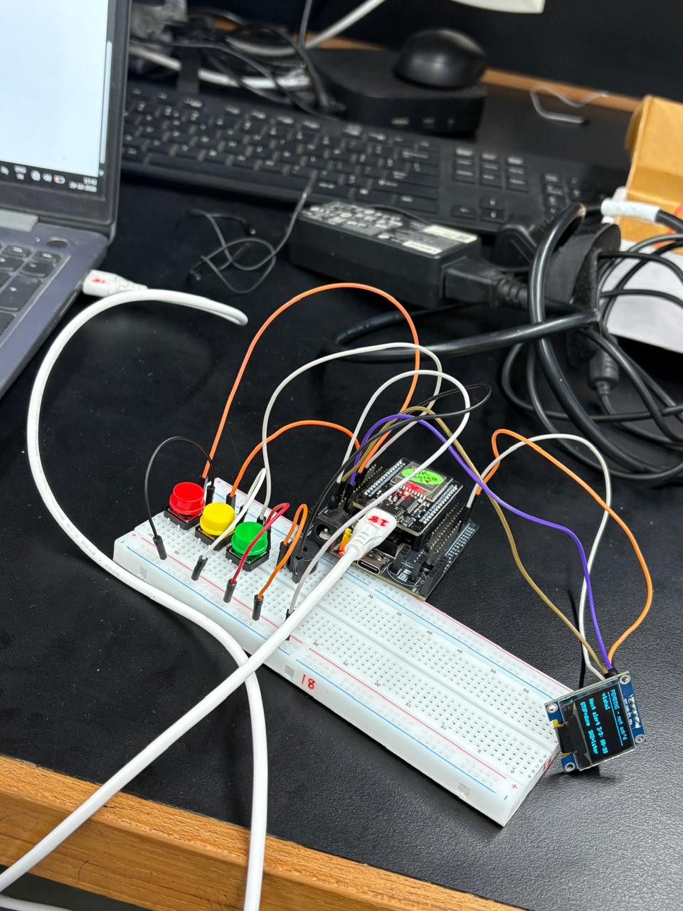
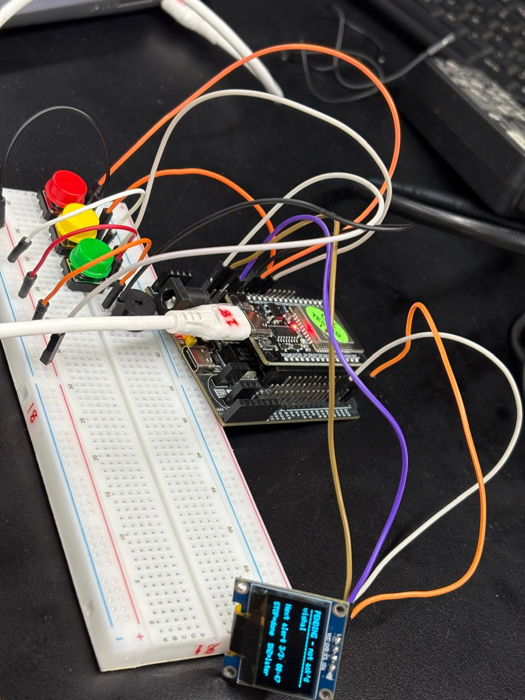
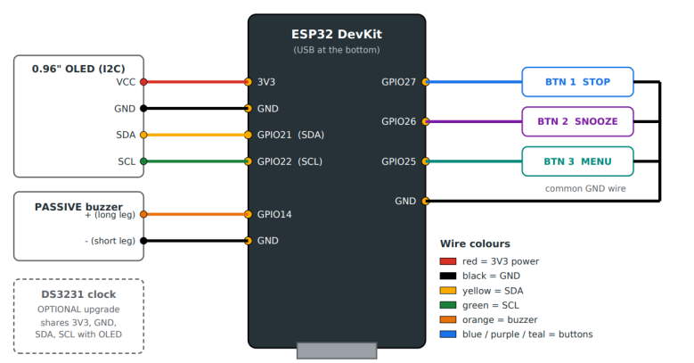
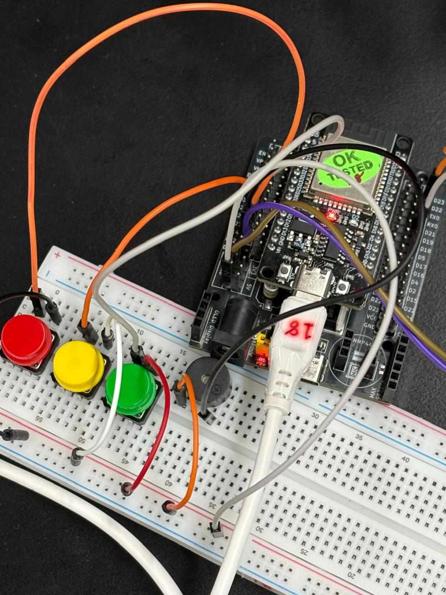

# Smart Daily Reminder Assistant (Edge Computing Edition)

[](https://www.espressif.com/)
[](https://www.arduino.cc/)
[-green.svg)](https://github.com/esp8266/Arduino)
[](https://github.com/adafruit/Adafruit_SSD1306)
[](LICENSE)
[](#testing-and-observed-behaviour)

An embedded, 100% offline Internet of Things (IoT) desk assistant designed to manage schedules, university lectures, exams, assignments, and personal events. Built around the **ESP32 microcontroller**, the system implements a pure **edge-computing architecture**: all schedule data, web dashboard services, and alert algorithms run directly on the chip without relying on cloud services, external databases, or an active internet connection.

---

## 📸 Prototype & Visual Showcase

<div align="center">
  <table style="width: 100%; border: none;">
    <tr>
      <td align="center" width="50%">
        
        <br/><b>Assembled Desk Assistant Prototype</b>
      </td>
      <td align="center" width="50%">
        
        <br/><b>OLED Real-Time Reminder Alert & Status</b>
      </td>
    </tr>
    <tr>
      <td align="center" width="50%">
        
        <br/><b>Pin Connection & Wiring Schematic</b>
      </td>
      <td align="center" width="50%">
        
        <br/><b>Breadboard Layout with Push Buttons & Buzzer</b>
      </td>
    </tr>
  </table>
</div>

---

## 🌟 Key Highlights & Edge Computing Advantages

- **Zero Cloud Dependency**: Operates entirely offline. Protects privacy and guarantees prompt reminder triggering regardless of internet outages or router disconnects.
- **Self-Hosted Wi-Fi Access Point & Web Server**: Broadcasts an independent local network (`SmartReminder`) and serves a responsive configuration dashboard directly from ESP32 flash at `http://192.168.4.1`.
- **Automatic Client-to-Device Time Synchronization**: When any phone or laptop opens the dashboard, the browser automatically sends the current system epoch (`Date.now()`) to `/api/settime`. The ESP32 sets its internal real-time clock without needing NTP servers.
- **On-Chip Persistent Flash Storage**: Utilizes LittleFS to serialize and save reminder records into `/reminders.json`, preserving timetable entries across power cycles and reboots (capacity: up to 100 reminders).
- **Intelligent Multi-Stage Alert Logic**:
  - Automatically triggers up to **3 alarms** per scheduled reminder spaced **5 minutes apart**.
  - Rings for **30 seconds** with an acoustic 3-beep tone using LEDC PWM.
  - Automatically marks unacknowledged events as `MISSED` after 10 minutes and 30 seconds.
- **Tactile 3-Button Control Interface**:
  - 🔴 **STOP (GPIO 27)**: Acknowledges alert, marks reminder as `DONE`, silences buzzer, and cancels remaining alert attempts (active even during the quiet interval between rings).
  - 🟡 **SNOOZE (GPIO 26)**: Postpones alarm by 10 minutes and resets the alert cycle.
  - 🟢 **MENU (GPIO 25)**: Navigates through 3 OLED pages:
    - *Page 0*: Next upcoming reminder & live countdown.
    - *Page 1*: Agenda overview of scheduled events.
    - *Page 2*: System diagnostics (time, WiFi status, storage count, LittleFS flash usage).
- **Bulk Timetable Import**: Add full weekly college timetables with a single copy-paste using the bulk import tool.

---

## 🛠️ System Architecture

```mermaid
flowchart TD
    subgraph Client ["Client Device (Phone / Laptop)"]
        Browser["Web Browser (http://192.168.4.1)"]
    end

    subgraph ESP32 ["ESP32 Edge Microcontroller"]
        AP["Wi-Fi Access Point (SSID: SmartReminder)"]
        WS["Embedded Web Server (Port 80)"]
        FS[("LittleFS Flash (/reminders.json)")]
        Clock["System RTC (Internal / DS3231)"]
        Scheduler["Core Alert Scheduler Engine"]
    end

    subgraph Peripherals ["Physical Hardware Interface"]
        OLED["0.96\" I2C OLED (SSD1306 - 128x64)"]
        Buzzer["Passive Piezo Buzzer (LEDC PWM)"]
        BTN1["STOP Button (GPIO27 - Red)"]
        BTN2["SNOOZE Button (GPIO26 - Yellow)"]
        BTN3["MENU Button (GPIO25 - Green)"]
    end

    Browser <==>|Local Wi-Fi Connection| AP
    AP <--> WS
    WS <--> Clock
    WS <--> FS
    FS <--> Scheduler
    Clock --> Scheduler
    Scheduler --> OLED
    Scheduler --> Buzzer
    BTN1 --> Scheduler
    BTN2 --> Scheduler
    BTN3 --> OLED
```

---

## ⚡ Hardware Pinout & Wiring

The circuit operates at 3.3V logic provided directly from the ESP32 DevKit.

| Component | Pin / Terminal | ESP32 GPIO | Description / Role |
| :--- | :--- | :--- | :--- |
| **0.96" OLED Display** | VCC | `3V3` | 3.3V Power |
| (SSD1306, 128x64, I2C 0x3C) | GND | `GND` | Ground |
| | SDA | `GPIO 21` | I2C Data line |
| | SCL | `GPIO 22` | I2C Clock line |
| **Passive Piezo Buzzer** | (+) Long leg | `GPIO 14` | PWM audio tone generation via LEDC |
| | (-) Short leg | `GND` | Ground |
| **STOP Button (Red)** | Terminal 1 | `GPIO 27` | Acknowledge & silence alert (internal pull-up) |
| | Terminal 2 | `GND` | Ground |
| **SNOOZE Button (Yellow)** | Terminal 1 | `GPIO 26` | Postpone alarm 10 mins (internal pull-up) |
| | Terminal 2 | `GND` | Ground |
| **MENU Button (Green)** | Terminal 1 | `GPIO 25` | Cycle OLED display pages (internal pull-up) |
| | Terminal 2 | `GND` | Ground |
| **DS3231 RTC Module** *(Optional)* | VCC / GND / SDA / SCL | `3V3` / `GND` / `GPIO 21` / `GPIO 22` | Optional battery-backed RTC (shares I2C bus) |

> [!NOTE]
> All push buttons use the ESP32 internal pull-up resistors (`INPUT_PULLUP`). When pressed, the pins are connected to `GND` (reading `LOW`). Software debouncing (40 ms) is implemented to eliminate mechanical contact chatter.

---

## 📁 Repository Structure

```text
Smart_Reminder_EDGE/
│
├── docs/
│   ├── Smart_Daily_Reminder_Project_Report_Final.pdf   # Complete academic project report
│   └── images/
│       ├── prototype_overview.jpg                      # Assembled prototype photo
│       ├── oled_display.jpg                            # Close-up of OLED notification
│       ├── wiring_diagram.png                          # Schematic wiring diagram
│       └── circuit_detail.jpg                          # Breadboard and button details
│
├── hardware_test/
│   └── hardware_test.ino                               # Pre-flight diagnostic sketch
│
├── smart_reminder_edge/
│   ├── smart_reminder_edge.ino                         # Main firmware source code
│   └── web_page.h                                      # Embedded web dashboard (HTML/CSS/JS)
│
├── .gitignore                                          # Git ignore rules for Arduino/PlatformIO
└── README.md                                           # Project documentation and guide
```

---

## 🚀 Getting Started

### 1. Requirements & Dependencies
- **Arduino IDE** (v1.8.19 or v2.x) with ESP32 board support package installed (supports ESP32 Arduino Core 2.x and 3.x).
- Required Arduino Libraries (installable via Arduino Library Manager):
  - **ArduinoJson** (v7.x)
  - **Adafruit SSD1306**
  - **Adafruit GFX Library**
  - *(Optional)* **RTClib** (only if `USE_DS3231` is enabled)

### 2. Pre-Flight Diagnostic Test
Before uploading the main firmware, flash the test sketch located in `hardware_test/`:
1. Open [`hardware_test/hardware_test.ino`](hardware_test/hardware_test.ino) in Arduino IDE.
2. Select your board (**ESP32 Dev Module**) and correct COM port.
3. Upload the sketch.
4. The OLED screen will display button states. Press each button to test the display readout and buzzer tones (Red: 1000 Hz, Yellow: 1500 Hz, Green: 2000 Hz).

### 3. Uploading the Main Firmware
1. Open [`smart_reminder_edge/smart_reminder_edge.ino`](smart_reminder_edge/smart_reminder_edge.ino).
2. Configure settings if desired:
   ```cpp
   const char* AP_SSID = "SmartReminder";        // Wi-Fi hotspot name
   const char* AP_PASS = "reminder123";          // Wi-Fi password (min 8 characters)
   const char* TZ_INFO = "IST-5:30";             // Time zone offset
   ```
3. Click **Upload**.

---

## 📱 Operating Instructions

1. **Power On**: Plug the ESP32 into a 5V USB power adapter, power bank, or laptop.
2. **Connect to Wi-Fi**: On your mobile phone or laptop, connect to:
   - **SSID**: `SmartReminder`
   - **Password**: `reminder123`
3. **Open Dashboard**: Navigate to **`http://192.168.4.1`** in any web browser.
4. **Time Sync**: The dashboard automatically synchronizes your device's clock to the ESP32 on load.
5. **Manage Reminders**:
   - **Add Individual**: Specify title, category (Class, Exam, Assignment, Meeting, etc.), date/time, and repeat mode (None, Daily, Weekly).
   - **Bulk Import**: Paste entire timetables in the format:
     ```text
     2026-10-12 10:00, Sensors & Actuators [H1], Class, weekly
     2026-10-12 11:15, Digital Signal Processing, Class, weekly
     2026-10-14 14:00, Embedded Systems Exam, Exam, once
     ```
6. **Physical Controls during Alerts**:
   - **STOP Button**: Silences alarm and marks status as `DONE`.
   - **SNOOZE Button**: Silences buzzer and reschedules reminder for 10 minutes later.
   - **MENU Button**: Toggles between OLED status views.

---

## 🧪 Testing and Observed Behaviour

The system has undergone thorough hardware verification against a 14-case test checklist:

| Test Case | Scenario | Observed Behaviour |
| :---: | :--- | :--- |
| **TC-01** | First boot without clock set | OLED alerts user to connect to dashboard; alarms remain disabled until time is synced. |
| **TC-02** | Wi-Fi hotspot connection | Phone connects to `SmartReminder`; dashboard loads instantaneously at `192.168.4.1`. |
| **TC-03** | Time synchronization | Browser timestamp sent; ESP32 system clock updates immediately without NTP. |
| **TC-04** | Single reminder creation | Record stored in `/reminders.json` on LittleFS; visible on dashboard and OLED. |
| **TC-05** | Alarm sequence trigger | At scheduled time, OLED flashes event title; buzzer emits 3-tone pattern. |
| **TC-06** | STOP during ringing | Buzzer silences instantly; event marked `DONE`; future repeat slots cancelled. |
| **TC-07** | STOP during silent gap | Works during the 5-minute quiet gap between alert slots; prevents subsequent alarms. |
| **TC-08** | SNOOZE action | Silences current alarm; restarts alert sequence 10 minutes later. |
| **TC-09** | Unattended alert timeout | After 3 ringing attempts (total 10m 30s), event is automatically tagged `MISSED`. |
| **TC-10** | OLED page navigation | MENU button cycles: Next Reminder $\to$ Agenda $\to$ System Info. |
| **TC-11** | Weekly recurring reminders | Successfully advances start timestamp by 7 days upon completion. |
| **TC-12** | Power cycle persistence | Reminders and completed states persist in LittleFS across sudden power disconnects. |
| **TC-13** | Simultaneous reminders | Scheduler prioritizes earliest record; queues subsequent alerts cleanly. |
| **TC-14** | Bulk import & Cleanup | Bulk timetable parsed correctly; `Clear finished` safely purges stale records. |

---

## 👥 Authors & Team

Developed as an academic edge IoT project by:
- **Jaydeep Parmar** (23BIT133)
- **Tadvi Yatharth** (23BIT143)
- **Dev Mehta** (23BIT145)

Detailed system design, mathematical alert scheduling formulas, and test records can be referenced in the [Project Report (PDF)](docs/Smart_Daily_Reminder_Project_Report_Final.pdf).

---

## 📄 License

This project is licensed under the [MIT License](LICENSE) — free to use, modify, and distribute for educational and personal use.
